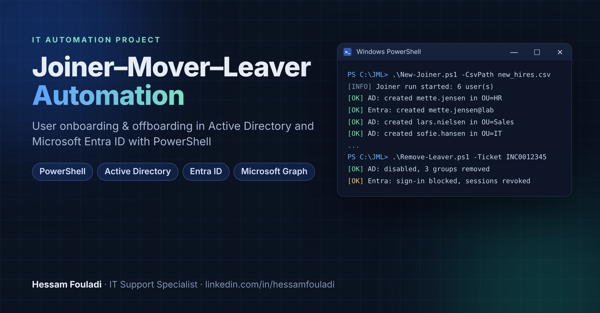
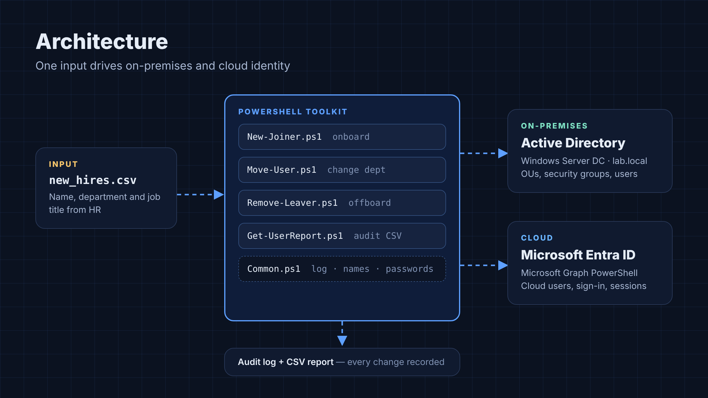
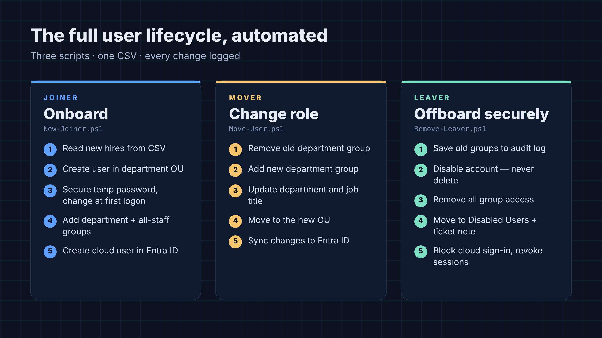

# Joiner–Mover–Leaver Automation
### Active Directory · Microsoft Entra ID · PowerShell



A PowerShell toolkit that automates the full user lifecycle in a hybrid lab:
**onboarding (Joiner)**, **department changes (Mover)** and **secure offboarding (Leaver)**,
in on-premises Active Directory and Microsoft Entra ID (through Microsoft Graph PowerShell).

Built by **Hessam Fouladi**, IT Support Specialist, as a home-lab project.
Connect with me on LinkedIn: [linkedin.com/in/hessamfouladi](https://www.linkedin.com/in/hessamfouladi)

---

## Why
User accounts are among the most common service desk tasks, and they are easy to get wrong.
A new colleague can start without access, or a leaver's account can stay active. These scripts
do the work the same way every time, follow least-privilege rules and log every change for audit.

## Architecture


## Features
| Script | What it does |
|---|---|
| `New-Joiner.ps1` | Reads `new_hires.csv` and creates users in the right OU with a random temporary password ("change at next logon"). Adds department and all-staff groups, and can also create the cloud user in Entra ID |
| `Move-User.ps1` | Moves a user to a new department: OU, groups and job title, in AD and Entra ID |
| `Remove-Leaver.ps1` | Disables the account (it is never deleted) and removes all groups. Writes the date and ticket number in the description and moves the account to `Disabled Users`. In Entra ID it blocks sign-in and revokes sessions |
| `Get-UserReport.ps1` | Exports a CSV of all users with department, title, enabled status, last logon and groups |
| `Common.ps1` | Shared logging, username generation (handles æ/ø/å and duplicates), and the secure password generator |



## Security choices
- **Disable, never delete.** Leavers can be restored, and the audit trail stays intact.
- **Least privilege.** Access comes only from department groups, and all of it is removed on offboarding.
- **Audit log.** Every action is written with a timestamp and the admin's name, and a leaver's old groups are saved before removal.
- **No passwords in logs.** Temporary passwords are only shown on screen, for secure handover.
- **`-WhatIf` support.** Every script can preview its changes before running them for real.

## Lab setup
1. Windows Server (evaluation) VM promoted to a domain controller: `lab.local`
2. Windows 10/11 client joined to the domain
3. OUs: `Users\IT`, `Users\Sales`, `Users\HR`, `Disabled Users`
4. Groups: `GRP-IT`, `GRP-Sales`, `GRP-HR`, `GRP-AllStaff`
5. Free Azure account for a Microsoft Entra ID tenant
6. `Install-Module Microsoft.Graph -Scope CurrentUser`

Running `setup/Initialize-Lab.ps1` creates the OUs and groups for you.

## Usage
```powershell
cd scripts
# Preview first
.\New-Joiner.ps1 -CsvPath ..\samples\new_hires.csv -WhatIf
# Run in AD + Entra ID
.\New-Joiner.ps1 -CsvPath ..\samples\new_hires.csv -IncludeEntra -CloudDomain yourtenant.onmicrosoft.com

.\Move-User.ps1     -SamAccountName mette.jensen -NewDepartment Sales -NewJobTitle "Account Manager"
.\Remove-Leaver.ps1 -SamAccountName lars.nielsen -Ticket INC0012345 -IncludeEntra -CloudDomain yourtenant.onmicrosoft.com
.\Get-UserReport.ps1
```

## Knowledge base
- [KB-001 How to onboard a new user](docs/KB-001-Onboard-a-user.md)
- [KB-002 How to offboard a leaver](docs/KB-002-Offboard-a-user.md)
- [KB-003 Troubleshooting script errors](docs/KB-003-Troubleshooting.md)

## Screenshots
_Add your own screenshots to `images/screenshots/`: the OU tree, the script output, users in the Entra admin center, a disabled leaver and the CSV report._

## What I learned
- Managing AD and Entra ID objects with PowerShell and Microsoft Graph
- Writing safe scripts with input validation, error handling, `-WhatIf` and logging
- Designing offboarding with security and audit in mind
- Writing documentation that a colleague can follow

## Next steps
- Welcome email to the new user's manager through Microsoft Graph
- Nightly report with Task Scheduler
- Licence assignment for Microsoft 365

> ⚠️ Lab project. Test with `-WhatIf` and never run it against a production environment without approval.

---
**Author:** Hessam Fouladi · [LinkedIn](https://www.linkedin.com/in/hessamfouladi) · hesfouladi@gmail.com
